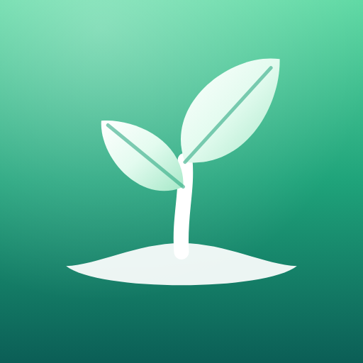
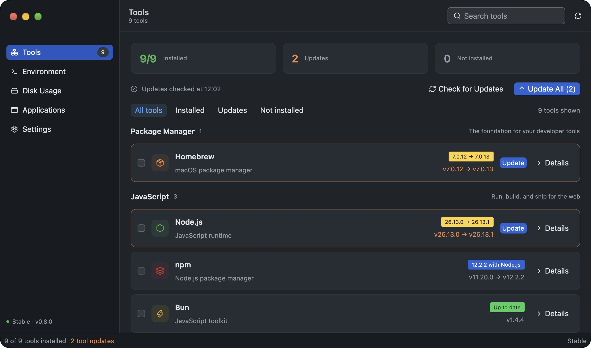
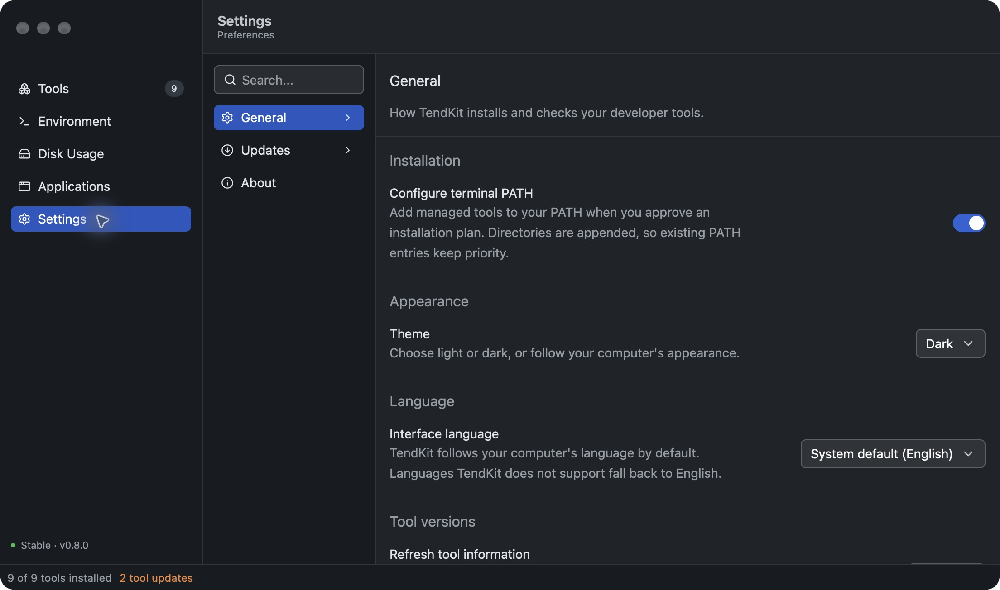

#  TendKit

A native macOS developer environment manager, built with Rust and [GPUI](https://gpui.rs).

| Tools | Settings |
| --- | --- |
|  |  |

TendKit detects Homebrew, Node.js, npm, Bun, Python, Rust, Codex, Claude Code, and
OpenCommit, then builds an install or update plan for the tools you select. Nothing
changes until you approve the plan. Progress, logs, and before/after versions appear
live, and you can cancel the operation at any time.

## Get started

TendKit supports macOS 15 or later on Apple Silicon. Download the latest build from
[GitHub Releases](https://github.com/cagatayldzz/tendkit/releases), or follow the
[development guide](docs/development.md) to build it locally. Local development
requires Command Line Tools, stable Rust and Cargo, and Bun.

Windows and Linux builds are inspection previews; tool installation and automatic
updates are macOS-only.

## Documentation

- [Tools](docs/tools.md) — tool management, language, self-update
- [Development](docs/development.md) — commands, workspace packages, engine queries
- [Architecture](docs/architecture.md) — crate layers and data flow
- [Protocol](docs/PROTOCOL.md) — engine protocol
- [Platform support](docs/platform-support.md) — supported platforms
- [Releasing](docs/releasing.md) — CI, release workflow, secrets
- [Project rules](AGENTS.md) — conventions for contributors and AI agents
