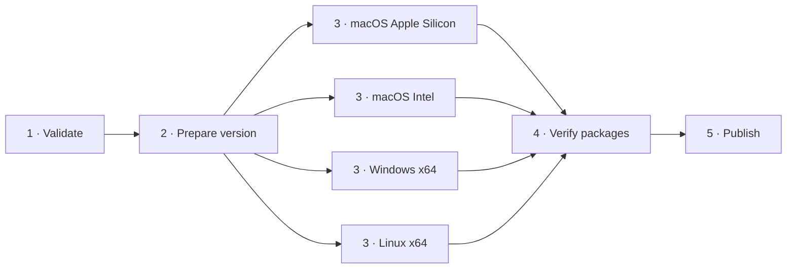

# Releasing

CI runs script checks, formatting, layers, and core Rust tests on Ubuntu for
every push to `main` and pull request. A newer push cancels outdated CI runs.
Full macOS and Windows application checks run as part of the release workflow. To publish a release,
run `bun run release` from a clean `main` (requires `gh auth login`), or start
**Actions → Release** manually.

The version bump is derived from commit messages since the last tag
(`feat:` → minor, `type!:` / `BREAKING CHANGE:` → major, otherwise patch).
Release notes are generated from commit titles with OpenAI. Native build jobs
produce macOS Apple Silicon and Intel ZIPs, a Windows x64 ZIP, and Linux x64
TAR/DEB packages. Both macOS apps are signed with Developer ID and notarized.
A combined `SHA256SUMS.txt` covers all five packages. Nothing is published unless
the checks and every native build and engine protocol smoke test pass.

Windows and Linux are inspection previews: tool installation and automatic app
updates remain macOS-only. Windows packages are unsigned. See
[platform support](docs/platform-support.md) for installation, runtime
requirements, and the exact support boundaries.

The release graph follows the work order. Validation finishes before version
preparation or platform builds start. Native application tests run inside their
build jobs, and only verified artifacts reach publication.

Required repository secrets:

| Secret | Purpose |
| --- | --- |
| `OPENAI_API_KEY` | Release notes |
| `APPLE_CERTIFICATE_BASE64` | Base64-encoded Developer ID Application `.p12` |
| `APPLE_CERTIFICATE_PASSWORD` | Password for the `.p12` |
| `APPLE_ID` | Apple Developer account email |
| `APPLE_TEAM_ID` | Team identifier |
| `APPLE_APP_SPECIFIC_PASSWORD` | App-specific password for notarization |
